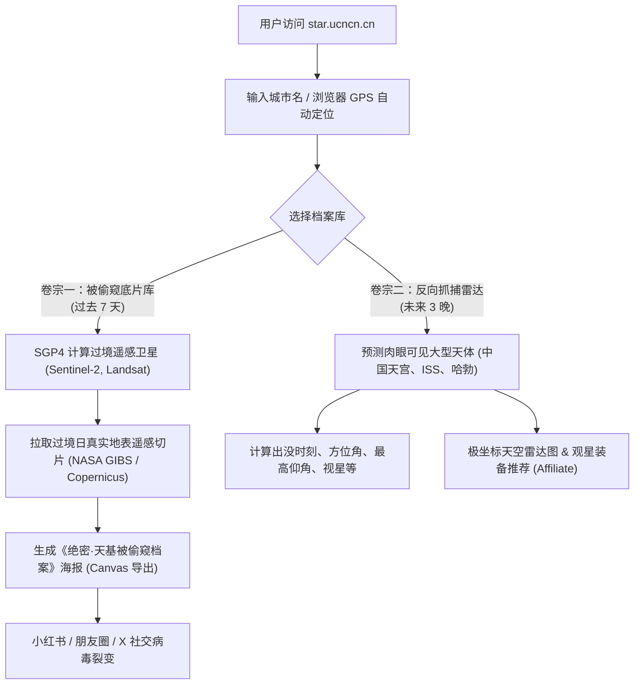

# 🛰️ 太空偷窥局 (Space Peep Bureau - SPB)
> **独立站产品需求说明书 (PRD & Architecture Specification)**  
> **访问域名**：`star.ucncn.cn`  
> **所属归属**：独立二级域名项目（模式 A，与 ucncn.cn 主站解耦）  
> **版本**：v1.0.0 (Release Candidate)  
> **状态**：已立项定稿，待开发对接

---

## 1. 品牌与定位全貌 (Brand Identity)

| 维度 | 规范与内容 |
| :--- | :--- |
| **中文名称** | **太空偷窥局** |
| **英文代号** | **Space Peep Bureau (SPB)** / **OrbitPeep** |
| **上线域名** | `https://star.ucncn.cn` |
| **核心定位** | 融合**猎奇社交裂变（天基偷窥底片回溯）**与**硬核实用观测（空间站/肉眼可见卫星反向抓捕）**的双核轻量独立站。 |
| **主 Slogan** | **“你以为你在独处，其实头顶有 17,000 颗眼睛在看你。”** |
| **副 Slogan** | **“白天调取被偷拍底片，今晚抬头反抓空间站。”** |
| **视觉基调** | **绝密解密档案风 (Confidential Dossier)** + **深空极客终端 (Cyber Console)**。<br>暗黑底色（#0a0d14）、荧光青/雷达绿高亮（#00ffc8）、十字瞄准网格、解密打字机效果、红色【绝密】钢印。 |

---

## 2. 用户故事与双核业务流 (Dual-Core Features)



---

### 卷宗一：【被偷窥底片库】（Past Evidence）

1. **定位与输入**：
   * 支持一键调用浏览器 HTML5 Geolocation 获取经纬度；
   * 支持输入城市中英文名称，通过极轻量地理接口（Photon / 本地大城市坐标库）极速反查。
2. **天基过境检索**：
   * 调取预置的高分辨率遥感卫星星历（Sentinel-2A/2B、Landsat 8/9 等）；
   * 通过 `satellite.js` 纯前端计算过去 7 天内，星下点距离用户坐标 `< 150km` 的所有有效过境记录；
   * 呈现卡片列表：过境精确时间戳、卫星编号、飞行高度（~786 km）、过境仰角、当日云量。
3. **真实卫星底片调取**：
   * 对接过境日期的开放遥感数据瓦片（NASA GIBS / Sentinel-2 L2A 开放接口），展示用户所在区域上空的真实地表影像；
   * 提供“云量过滤（默认仅显示晴空/少云图）”。
4. **《绝密·天基被偷窥档案》海报生成（核心裂变点）**：
   * 纯前端 HTML5 Canvas 绘制一张竖版（9:16）电影级解密档案海报：
     * 顶部红色醒目标签：`【绝密 · 太空偷窥局监视档案】`
     * 档案号：`SPB-2026-[随机6位识别码]`
     * 中心地表影像：带经纬度网格线与绿色十字准星，正对用户城市；
     * 核心文案：*“目标城市：[城市名] ｜ 监视星：Sentinel-2A ｜ 偷窥高度：786km ｜ 经证实，过去 7 天已有 [N] 颗卫星从你头顶按下快门。”*
     * 底部印章：太空偷窥局专属电子公章 + 二维码（引导扫码回访）。

---

### 卷宗二：【反向抓捕雷达】（Future Passes）

1. **高价值反抓目标库**：
   * 🇨🇳 **中国空间站（CSS / 天宫）**：重点高亮，标注“国家重器，超高反光”；
   * 🛰️ **国际空间站（ISS）**：全天最亮人造天体（视星等常达 -3.0，亮于金星）；
   * 🔭 **哈勃空间望远镜 (HST)** / **高反光亮星**。
2. **过境时间轴与参数计算**：
   * 预测未来 72 小时（今晚、明晚、后晚）在夜间且满足可见条件的过境事件（卫星被太阳照亮、地面已入夜）；
   * 关键参数：
     * 升起时间与方位（如：`20:41 西南 220°`）；
     * 最高仰角时刻与高度（如：`20:44 头顶仰角 76°，亮度 -2.8 等`）；
     * 降落消失时间与方位（如：`20:47 东北 45° 没入地影`）。
3. **天空极坐标雷达视图**：
   * 极简 Canvas 渲染半球天顶雷达，直观画出今晚空间站从地平线升起、横穿夜空的圆弧光轨。
4. **反抓装备与变现触点**：
   * 提示：*“本场过境肉眼清晰可见 / 建议搭配 7x50 双筒望远镜获得最佳细节”*；
   * 植入观星装备、便携望远镜、手机长焦夹具的电商联盟推荐卡片。

---

## 3. 技术栈与架构设计 (Zero-Cost & Serverless)

本项目严格贯彻**“零服务器运维、零后端、纯前端高内聚”**原则：

| 模块 | 选型 | 说明 |
| :--- | :--- | :--- |
| **页面基座** | HTML5 + Tailwind CSS + Vanilla JS / Alpine.js | 单文件或轻量多模块，秒开、零编译负担或极轻构建。 |
| **轨道算法** | `satellite.js` (SGP4/SDP4 算法库) | 纯浏览器端多线程/异步计算，毫秒级得出星下点经纬度和仰角方位。 |
| **星历数据源 (TLE)** | `assets/satellites.json` (静态预置) | 打包约 30~50 颗重点观测与遥感卫星的 TLE。配置 GitHub Actions 每 24 小时自动更新 CelesTrak 最新星历。 |
| **遥感影像服务** | NASA GIBS (Global Imagery Browse Services) / Copernicus Open WMTS | 免费、免鉴权、跨域友好，提供每日全天球合成地表切片。 |
| **地理反查** | OpenStreetMap Photon API + 国内大城市离线词典 | 输入“北京”秒级解析出 `lat: 39.9042, lon: 116.4074`。 |
| **海报合成** | HTML5 Canvas 原生 API | 客户端即时渲染导出为 PNG，无需向后端上传图片。 |
| **部署环境** | Nginx 静态服务 / Cloudflare Pages | 配置独立域名 `star.ucncn.cn`。 |

---

## 4. 商业变现与流量增长闭环

1. **流量第一跳（社交裂变）**：
   * 用户因“偷窥”噱头测出自己的底片档案，自发下载海报发圈，带来无成本回流；
2. **流量第二跳（SEO 与 AI 搜索引用）**：
   * 页面底部内嵌 1500 字以上专业科普与问答结构：
     * 《空间站肉眼观测指南与最佳时间表》
     * 《如何理解卫星影像的分辨率与成像波段？》
     * 《SGP4 轨道模型与星下点计算原理》
   * 注入 `Schema.org` 的 `FAQPage` 与 `SoftwareApplication` JSON-LD，争取 Google AI Overviews 和 Perplexity 推荐。
3. **变现闭环**：
   * **联盟佣金（主要利润点）**：针对观星反抓板块，挂接高客单价天文望远镜、户外摄影配件返佣；
   * **展示广告**：Google AdSense 页面非侵入式广告位。

---

## 5. 项目工程结构规范 (Directory Layout)

根据 `DEVELOPMENT_SPEC.md` 规范，本工程完全存放于 `G:\work\code\website\ucncn\star\`：

```text
g:\work\code\website\ucncn\star\
├── PRD.md                 # 本需求与架构文档
├── README.md              # 快速上手与运行指南
├── index.html             # 核心单页（太空偷窥局终端界面）
├── assets/
│   ├── js/
│   │   ├── satellite.min.js   # SGP4 轨道计算引擎
│   │   ├── app.js             # 业务逻辑与界面交互
│   │   └── poster.js          # Canvas 机密海报生成器
│   ├── css/
│   │   └── style.css          # 机密档案 UI 样式与动画
│   ├── data/
│   │   ├── satellites.json    # 核心目标卫星 TLE 星历数据
│   │   └── cities.json        # 常用大城市经纬度字典
│   └── images/                # 机密印章、准星图标等素材
└── scripts/
    └── update_tle.py          # 定时拉取 CelesTrak 最新星历脚本
```

---

## 6. 后续对话开发执行任务清单 (Developer Checklist)

在新对话启动时，可直接按以下 4 阶段推进落地：

* [x] **阶段一：脚手架与暗黑档案 UI 搭建**
  * 编写 `index.html`，实现机密档案风头部、坐标选择器、双卷宗 Tab 切换布局。 (已完成)
* [x] **阶段二：前端 SGP4 算法与星历数据接入**
  * 引入 `satellite.js` 与 `satellites.json`，跑通“输入经纬度 -> 输出过境时间与仰角”的核心计算闭环。 (已完成)
* [x] **阶段三：底片调取与 Canvas 机密海报生成**
  * 对接 NASA GIBS 开放瓦片接口加载卫星图；
  * 实现一键绘制并下载《绝密·天基被偷窥档案》海报。 (已完成)
* [x] **阶段四：反向抓捕雷达与上线部署**
  * 绘制夜空极坐标雷达图，展示天宫与 ISS 过境光轨；
  * 补充底部 SEO 长文与 FAQ，配置 Nginx `star.ucncn.cn` 绑定与上线。 (已完成)
